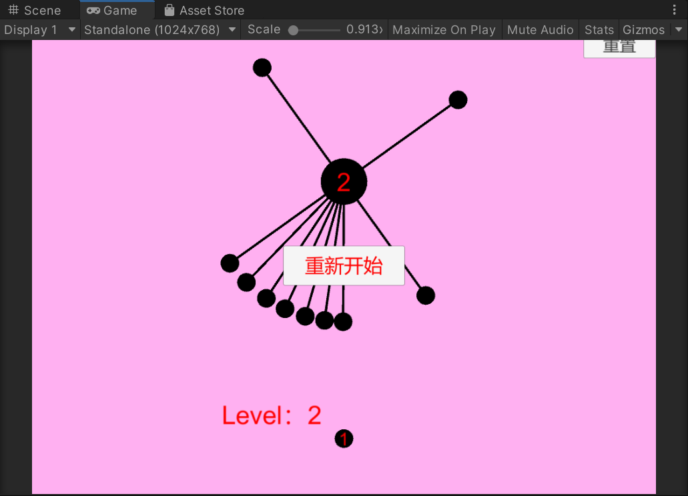

# 见缝插针小游戏｜Unity2D
> 模仿微信小程序见缝插针进行功能优化开发

## 🎮项目简介
模仿微信小程序《见缝插针》的2D休闲小游戏。
玩家点击屏幕发射针，插入旋转圆盘，不能和已经存在的针碰撞；全部针插入完成即可通关，碰撞则游戏失败。
针对原版小程序痛点：**新增剩余待发射针可视化UI，玩家直观看到剩余发射次数；增加通关、失败、发射音效反馈；关卡递进，难度随关卡提升。**

## 🛠技术栈
- 引擎：Unity 2D
- 语言：C#
- 技术点：碰撞检测Trigger、游戏状态管理器、ScriptableObject关卡数据管理、预制体动态生成、UI动态文本生成、PlayerPrefs关卡持久化存储、音频反馈。

## 📸运行截图

## 🎯核心功能
1. 关卡系统：关卡递进，针数量、转盘难度随关卡上升，使用PlayerPrefs保存关卡进度
2. 剩余针数可视化UI：动态生成文本显示待发射针，解决原版无剩余针提示的问题
3. 碰撞区分逻辑：区分合法碰撞（撞到中心圆盘）、非法碰撞（针互相碰撞触发GameOver）
4. 音效系统：发射、成功插入、游戏失败、通关全部配有音频反馈
5. 游戏控制：重新开始、重置回到第一关按钮

## 📂脚本说明
- `GameController.cs`：全局游戏管理器，关卡管理、胜负状态、UI控制、场景切换
- `Spawn.cs`：预制体生成，生成转盘障碍、待发射针与UI计数文本
- `Up.cs`：针发射逻辑，点击交互、飞行移动、碰撞检测
- `Turn.cs`：控制中心圆盘旋转，控制旋转启停、旋转方向
- `LevelData.cs`：ScriptableObject，集中存储各个关卡配置参数

## 📦运行方式
1. 在Release下载 `见缝插针v1.0.zip`
2. 解压压缩包，打开exe直接运行Windows版本游戏

## ✨个人收获
练习Unity脚本通信、游戏状态管理、动态UI生成；针对现有产品做体验优化，理解游戏交互痛点如何通过代码解决。

